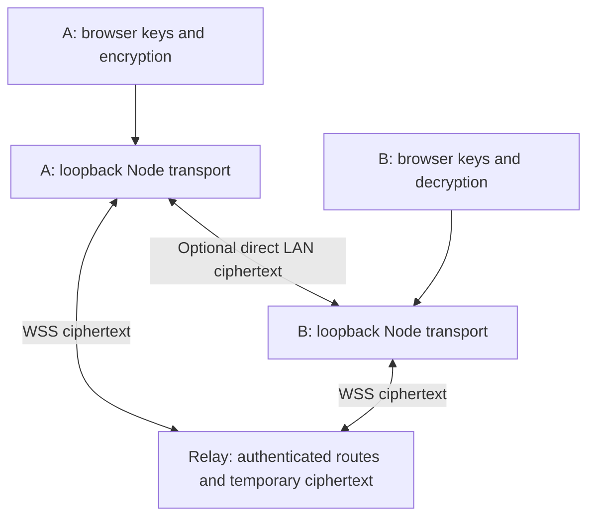

# Butter Chicken

Two people, local encryption, chat over LAN or the internet. Each computer runs `butter-chicken`, opens its own localhost UI, and keeps its own encrypted vault/history. A configured WSS relay lets paired friends use different Wi-Fi networks, ISPs, hotspots, cities or countries. Neither user needs the other's IP, router settings or port forwarding.

**This release includes relay implementations for both a self-hosted Node relay and a Cloudflare Worker relay.** For easy internet messaging and pairing, deploy the included Cloudflare Worker relay (`cloudflare/relay/`) to your Cloudflare account and configure the same worker URL on both computers (for example `BC_CLOUDFLARE_RELAY=butterchickenworker.bakri-downtime-sub.workers.dev`). You can also deploy the Node relay using [relay deployment and costs](relay/README.md). No paid messaging API, cloud database, authentication provider or account signup is part of the app; hosting/account limits depend on your chosen infrastructure.

This is a new application protocol using established libsodium primitives, not independently certified messaging software. There is no forward secrecy or ratchet. Review [SECURITY.md](SECURITY.md), [THREAT_MODEL.md](THREAT_MODEL.md), [PRIVACY.md](PRIVACY.md) and [SECURITY_AUDIT.md](SECURITY_AUDIT.md).

## Requirements

- Node.js **24.x** with npm, a current browser and terminal on each computer. Linux was tested; physical Windows/macOS testing remains pending.
- For internet chat: the same reachable WSS relay with a trusted TLS certificate, and outbound internet access on both computers. Public relay DNS may resolve IPv4/IPv6 according to host/network support; this is not physically verified on IPv6-only networks.
- For optional direct LAN chat: private IPv4 routing, TCP 4455 private-network firewall permission, optional UDP 5353 mDNS. Guest network isolation can prevent LAN optimization without preventing relay delivery.
- An npm global command directory on PATH. This is a CLI + localhost web app, not Electron, Tauri or a native executable.

## Using Butter Chicken From Anywhere (Cloudflare)

1. Install using the ZIP instructions below, then run `butter-chicken`.
2. Open the printed localhost URL, normally `http://localhost:3000`. Create/unlock your identity using a strong passphrase. Each person creates their own identity; never copy your friend's database.
3. Deploy the Cloudflare Worker relay once using [cloudflare/relay/README.md](cloudflare/relay/README.md) (it is preconfigured for `butterchickenworker.bakri-downtime-sub.workers.dev`), or use your own deployed compatible Cloudflare/relay URL.
4. Stop your local app with Ctrl+C. Open the `config.env` location printed by the launcher and add:

```dotenv
BC_CLOUDFLARE_RELAY=butterchickenworker.bakri-downtime-sub.workers.dev
# or: BC_RELAY_URL=wss://butterchickenworker.bakri-downtime-sub.workers.dev/relay
```

Use the same relay on both computers. Save the config and relaunch `butter-chicken`. On Windows the default file is `%LOCALAPPDATA%\ButterChicken\config.env`; macOS `~/Library/Application Support/ButterChicken/config.env`; Linux `${XDG_DATA_HOME:-~/.local/share}/butter-chicken/config.env`. The actual printed path is authoritative.

5. Your friend installs and runs the app, configures **exactly the same Cloudflare relay setting/URL**, and opens **their own localhost UI**. No IP exchange or router configuration is needed. You can also use the self-hosted Node relay from [relay/README.md](relay/README.md) if preferred.
6. A chooses **Create invitation** and privately shares the complete BC1 text or QR. It expires after ten minutes and includes the signed relay URL. Both apps must be online/unlocked during initial pairing.
7. B pastes/scans it and chooses **Connect to friend**. Compare every group of the safety code over an independent trusted call. Both check the comparison box and choose **I verified the code**. One confirmation alone cannot save trust.
8. Choose **Start chatting**. Send a message in each direction. A stranger's name is never identity verification.
9. Future launches reuse the pinned identity. Unlock to receive; sending to an offline friend works when a relay is configured and the pairing has the internet epoch.

Legacy LAN-only pairings can still use live LAN chat. Remove trust on **both** clients and pair once after configuring the relay to enable internet offline delivery. An old invitation without a relay URL still needs its reachable LAN endpoint for initial pairing.

### Path and message states

- **LOCAL**: a mutually authenticated direct LAN session. Discovery hints choose this path when available; failure falls back to the configured relay.
- **INTERNET**: your relay is connected. This does not by itself prove the friend's device is currently online. The separate friend connection indicator reports that state.
- **OFFLINE**: no active usable path. Local encrypted pending data is retained. No plaintext or insecure TLS downgrade occurs.

The composer displays **COMPOSING** while you type. Outgoing messages show **QUEUED** (saved encrypted locally), **SENDING** (submitted to a usable path), **SENT** (relay accepted temporary ciphertext), **DELIVERED** (friend's authenticated encrypted receipt confirms local save), **READ** (friend's active visible chat UI acknowledged display), or **FAILED** (relay queue rejected the attempt; the local copy remains for retry). READ means displayed by the app, not proof of human attention. LAN delivery can proceed directly from SENDING to DELIVERED without relay SENT.

The relay stores opaque signed envelopes for at most **24 hours**, with deletion on processing/consume or periodic expiry cleanup. Sender retries keep the same envelope and do not extend an existing relay row's expiry. If the relay copy expires, the sender's local pending copy remains and can be resubmitted later. Permanent chat history lives only on the two devices.

Relay disconnects retry automatically with exponential backoff, jitter and a 60-second cap, checked by a five-second client timer. Wi-Fi/IP changes, relay restart and sleep/resume use fresh authentication. Pending uploads are batched; reconnect restores saved pending envelopes. If the local Node process itself stops, restart it and reload/unlock the local page. Direct LAN listener bindings may need a local service restart after interface changes; internet fallback needs no friend's address.

### Architecture



The relay verifies fresh Ed25519 proofs and matching signed pair endorsements, but owns no private keys, box keys, archive keys, passphrases, pairing tokens or recovery secrets. Pairing display names/tokens are encrypted before leaving the browser. Public identities, pairing IDs, endpoint/traffic timing, message IDs and approximate sizes remain visible metadata. A malicious relay can delay/drop/reorder traffic; the pinned receiver verifies signatures, recipient, pairing epoch, ciphertext and persistent message IDs before accepting it. Sequence values are encrypted/authenticated and expose delayed ordering to the receiving UI; this is not a trusted global clock or strict contiguous delivery requirement.

## First-time installation from the final ZIP

Extract `ButterChicken-Final.zip`. Open a terminal in its `butter-chicken` folder. The ZIP contains complete source and a ready global-installation bundle, `butter-chicken-1.0.0.tgz`.

```bash
node --version
npm --version
npm install --global ./butter-chicken-1.0.0.tgz
butter-chicken --version
butter-chicken
```

The global install uses the included bundle and installs its production dependencies. It does not publish anything to npm. Keep the terminal running. Open **http://localhost:3000**, or the exact URL printed if you changed the port. Identity creation and unlocking happen in the graphical UI.

For source development or reproducibility from the same extracted folder:

```bash
npm ci
npm run check
npm run audit:security
npm run pack:release
npm install --global ./butter-chicken-1.0.0.tgz
```

`pack:release` builds the app and creates the installation bundle. The ready bundle avoids requiring development tools for ordinary installation. Do not install by an unverified similarly named npm registry package: use the local `./...tgz` path.

### User-writable global installation

If npm reports a permissions error, use your own prefix rather than changing system-directory permissions. On macOS/Linux:

```bash
npm config set prefix "$HOME/.npm-global"
export PATH="$HOME/.npm-global/bin:$PATH"
npm install --global ./butter-chicken-1.0.0.tgz
butter-chicken --version
```

Add the `export PATH=...` line to your shell startup file to retain it, then reopen the terminal. `$HOME` here is the user's existing home directory, not reassigned. On Windows PowerShell:

```powershell
npm config set prefix "$env:LOCALAPPDATA\npm-global"
$env:Path = "$env:LOCALAPPDATA\npm-global;$env:Path"
npm install --global .\butter-chicken-1.0.0.tgz
butter-chicken --version
```

Add `%LOCALAPPDATA%\npm-global` to your **user** PATH through Windows Environment Variables and reopen the terminal. If PowerShell blocks npm's `.ps1` shim, use `npm.cmd` and `butter-chicken.cmd`, or Command Prompt. Do not weaken system execution policy merely to launch this app.

## Normal launch, status and stop

From **any directory**:

```bash
butter-chicken
```

One foreground Node process starts the loopback UI/API and separate LAN WebSocket listener, opens/creates its encrypted-storage database, and prints the actual UI URL, LAN address, data directory and config-file path. It does not automatically unlock an identity. Open the browser yourself and create/unlock it. No second server command is needed.

Supported commands:

```bash
butter-chicken status
butter-chicken --version
butter-chicken --help
```

`status` checks the configured loopback port and displays running/not available, LAN address and whether a vault exists. It reveals no names, keys, messages, cookies or CSRF token. A not-running result exits with code 1. Configuration changes require restarting the service.

Stop the running app with **Ctrl+C in its original terminal**. There is no daemon, `stop` command, automatic updater or pretend update command. Closing that terminal also ends its foreground process, but Ctrl+C permits graceful closure.

**Localhost is your own computer.** B opens B's localhost UI. B does not enter A's localhost address. With a configured relay, both Node processes connect outbound over WSS. Discovery may use direct LAN frames on TCP 4455. Your friend never opens your localhost UI.

## Local history, identity and settings

Data is **outside the installation/repository** and does not depend on the launch directory:

| OS      | Default dedicated directory                                                                               |
| ------- | --------------------------------------------------------------------------------------------------------- |
| Windows | `%LOCALAPPDATA%\ButterChicken` (fallback: user home `AppData\Local\ButterChicken`)                        |
| macOS   | `~/Library/Application Support/ButterChicken`                                                             |
| Linux   | `$XDG_DATA_HOME/butter-chicken` when XDG_DATA_HOME is absolute; otherwise `~/.local/share/butter-chicken` |

Inside it, **`butter-chicken.sqlite`** contains the encrypted vault/history and replay records. Each computer has its own database. The exact active directory is printed at launch and by `status`. POSIX directories must be owned by your user with mode 0700; database files use 0600. Windows requires private account ACLs. Do not store this data in GitHub, a shared folder or the source tree.

Theme and auto-lock preferences are stored in this browser's localStorage for its localhost origin. Keys, pairing pins and messages are encrypted in SQLite. Browser preferences normally survive updates while the same browser profile and UI port are retained.

| Action                | Result on this computer                                                                           |
| --------------------- | ------------------------------------------------------------------------------------------------- |
| Lock                  | Disconnect, remove decrypted UI state and best-effort zero key buffers                            |
| Delete history        | Delete encrypted conversation; keep own identity, trust and replay IDs                            |
| Remove trusted device | Delete friend trust and local history; keep own identity                                          |
| Reset identity        | Delete vault, keys, history and replay IDs; keep a random non-authenticating discovery routing ID |

The other computer's data is not remotely deleted. While unlocked, Settings lets you change your passphrase. A separate random recovery key can set a new passphrase if the current one is forgotten; save it somewhere private and separate from this computer. If both the passphrase and recovery key are lost, the vault cannot be decrypted. Reset is destructive and does not recover the old identity or conversation. After identity reset/removal, both people remove old trust and compare a new pairing.

### Backup and updates

Stop with Ctrl+C before copying the **entire dedicated data directory** to a protected backup. It includes the encrypted vault, recovery-encrypted copy, history and optional configuration; keep both the passphrase and recovery key separately protected. Browser UI preferences are not included. Restoring an old database can restore deleted messages/trust and roll back replay records. There is no anti-rollback hardware guarantee. Do not copy live SQLite files or publish a backup.

Ordinary global reinstall/update replaces package files, **not** the user-data directory. Back up first, stop the running process, update from your trusted source and restart. Do not use `npm uninstall` as a history-reset mechanism. Future schema changes require reviewed migration instructions; this v1 release does not promise compatibility with arbitrary future builds.

If migrating an older development copy that used `.data/butter-chicken.sqlite`, stop it, preserve a backup, and copy that database into the printed new private data directory **only if no identity exists there yet**. Do not overwrite an existing vault or merge two identities. Keep the same passphrase.

## Configuration

Copy `.env.example` to the launcher’s printed `config.env` for global use. Development loads the project's `.env`. Actual environment values take precedence. No arbitrary working-directory `.env` is loaded by the global command.

| Variable              | Default                | Purpose                                                                                               |
| --------------------- | ---------------------- | ----------------------------------------------------------------------------------------------------- |
| `BC_CLOUDFLARE_RELAY` | blank                  | Cloudflare relay shortcut: host or full WSS URL (use `1` for `bakris-downtime-relay...workers.dev`) |
| `BC_RELAY_URL`        | blank                  | WSS internet relay; both friends use the exact same canonical URL ending `/relay`                     |
| `BC_UI_PORT`          | 3000                   | Loopback UI/API                                                                                       |
| `BC_LAN_PORT`         | 4455                   | Optional direct LAN transport                                                                         |
| `BC_LAN_HOST`         | auto                   | Private IPv4 interface, otherwise loopback                                                            |
| `BC_DISCOVERY`        | true                   | Local mDNS hints; false disables                                                                      |
| `BC_DATA_DIR`         | OS user-data path      | Absolute private storage path                                                                         |
| `BC_CONFIG_FILE`      | user-data `config.env` | Absolute config override                                                                              |

Production launch rejects `ws://` relay URLs. `npm run dev` permits explicit loopback `ws://127.0.0.1:8787/relay` only. The relay URL never contains user credentials or tokens. Signed invitations do not silently change your relay configuration. No development relay address is hardcoded into production assets.

## FREE OPTIONS

No per-message API fee or paid messaging/database dependency is introduced by the app. Internet relay options:
- **Cloudflare Worker relay (included):** deploy `cloudflare/relay/` to your Cloudflare account and use it for pairing/messaging (subject to Cloudflare account limits/terms). This is the easiest path for "my Cloudflare" setups.
- **Self-hosted Node relay:** deploy `relay/` on suitable infrastructure (for example a VM with Docker/Caddy). A qualifying provider free VM may be an option, subject to quotas/availability.

Read [cloudflare/relay/README.md](cloudflare/relay/README.md) and [relay/README.md](relay/README.md). No always-online hosted relay is guaranteed by this ZIP alone.

## OPTIONAL PAID / PRODUCTION OPTIONS

You may use a paid Cloudflare plan/resources for the Worker relay, or a public Linux VM/domain for the Node relay, depending on your needs. Confirm exact provider quotas, limits, taxes, and renewal terms before relying on any service. No payment, provider credentials, OpenAI APIs, Firebase, or managed message broker is configured by this project.

## Technology Stack & Tools

Versions below come from the finished manifest/lockfile or the actually queried verification runtime. Bundled SQLite/libsodium may vary with a different supported runtime/library build.

| Category                   | Technology                                       | Verified version                  | Purpose                                                  |
| -------------------------- | ------------------------------------------------ | --------------------------------- | -------------------------------------------------------- |
| Frontend                   | React / React DOM                                | 19.3.0 / 19.3.0                   | Graphical UI                                             |
| Language/type checker      | TypeScript                                       | 5.9.3                             | TS/TSX and strict compile checks                         |
| Build                      | Vite                                             | 8.3.3                             | Production frontend and development middleware           |
| Bundler                    | Rolldown                                         | 1.2.12, locked through Vite       | JavaScript/CSS assets                                    |
| Backend/runtime            | Node.js                                          | 24.19.0 tested; requires 24.x     | Native HTTP, filesystem, CLI and local servers           |
| Package manager            | npm                                              | 11.9.0 tested                     | Exact dependencies, lockfile, audit, pack and global bin |
| Database                   | SQLite via `node:sqlite` DatabaseSync            | SQLite 3.53.3 in tested Node      | Local encrypted vault/history/replay ledger              |
| Networking                 | ws                                               | 8.22.0                            | LAN and internet WebSockets                              |
| Discovery                  | bonjour-service                                  | 1.4.4                             | Optional mDNS/DNS-SD                                     |
| Crypto                     | libsodium-wrappers-sumo                          | 0.8.4; libsodium 1.0.22 queried   | Standard cryptographic operations in browser/worker      |
| Input schemas              | Zod                                              | 4.6.5                             | Strict protocol/API/storage validation                   |
| QR generation              | qrcode                                           | 1.5.4                             | Signed invite QR images                                  |
| QR decoding                | @zxing/browser / @zxing/library                  | 0.1.5 / 0.21.3                    | Image/camera QR decoding                                 |
| Test runner                | Node `node:test` / `node:assert`                 | Bundled with Node 24.19.0         | Unit, integration, CLI and defensive tests               |
| TS execution               | tsx                                              | 4.23.15                           | TypeScript development/tests                             |
| End-to-end browser         | Playwright                                       | 1.63.0                            | Isolated graphical flows                                 |
| Formatter                  | Prettier                                         | 3.5.3                             | Project formatting script                                |
| Packaging                  | Node filesystem/zlib ZIP exporter and `npm pack` | Node/npm versions above           | Complete ZIP and installable npm tarball                 |
| Supplementary verification | Python                                           | 3.12.14 in assessment environment | ZIP integrity inspection only; not needed to run the app |

The UI uses project-owned CSS and custom SVG glyphs, React hooks plus `ChatEngine`/`useSyncExternalStore`, and native History API routing. There is no Tailwind, component toolkit, third-party state/router library or icon package. The backend uses native `node:http`, not Express/Fastify; middleware checks are application code. SQLite uses prepared/bound SQL directly, without ORM/query builder. No attachments, Python/Rust runtime, Electron or Tauri is included.

The browser uses X25519 `crypto_box_easy` (XSalsa20-Poly1305), Ed25519 signatures and BLAKE2b identity/safety-code hashing. Libsodium RNG supplies keys/challenges/24-byte nonces. Argon2id (two passes, 64 MiB, 16-byte salt) derives the vault key. XChaCha20-Poly1305 encrypts vault and archives using separate keys/AAD. Normal platform TLS validation is used for WSS; no custom TLS or cryptographic algorithm is provided; static long-term box keys mean no forward secrecy.

Testing uses real disposable services/stores, a synthetic Backend for queue testing, child processes for crash isolation, deterministic field mutation, bounded socket stress, and Playwright route interception for lock races. There is no coverage percentage, coverage-guided fuzzer, Jest/Vitest, ESLint, dedicated taint analyzer, import sorter, pre-commit/Git hook or CI system. TypeScript plus the documented heuristic scan are the current static checks. The assessment environment's separate test-only Chromium 143.0.7499.0 is not shipped.

OpenSSL **3.0.13** was used only to generate disposable TLS-test certificates. Docker Engine/Compose v2 and Caddy 2 are optional relay deployment tools; no Docker/Caddy binary version was executed or claimed here. Record deployed image digests/version output on your server. No new npm dependency was added for the relay.

### Direct dependency inventory

The next two tables list all direct dependencies from `package.json`; the supplied `npm-shrinkwrap.json` locks transitive versions and integrity hashes and is included in the global installer. npm also honors this lock for `npm ci`.

#### Production dependencies

| Package                   | Exact version | Purpose                           |
| ------------------------- | ------------- | --------------------------------- |
| `@zxing/browser`          | 0.1.5         | Browser/camera QR adapter         |
| `@zxing/library`          | 0.21.3        | QR decoder and decoding hints     |
| `bonjour-service`         | 1.4.4         | mDNS LAN hints                    |
| `libsodium-wrappers-sumo` | 0.8.4         | Cryptographic APIs and worker KDF |
| `qrcode`                  | 1.5.4         | QR invite generation              |
| `react`                   | 19.3.0        | UI components/hooks               |
| `react-dom`               | 19.3.0        | DOM rendering                     |
| `ws`                      | 8.22.0        | WebSocket server/client transport |
| `zod`                     | 4.6.5         | Strict schemas                    |

#### Development dependencies

| Package                          | Exact version | Purpose                                     |
| -------------------------------- | ------------- | ------------------------------------------- |
| `@types/libsodium-wrappers-sumo` | 0.7.8         | Crypto TypeScript definitions               |
| `@types/node`                    | 24.10.1       | Node 24 TypeScript definitions              |
| `@types/qrcode`                  | 1.5.6         | QR generation TypeScript definitions        |
| `@types/react`                   | 19.2.7        | React TypeScript definitions                |
| `@types/react-dom`               | 19.2.3        | React DOM TypeScript definitions            |
| `@types/ws`                      | 8.18.1        | WebSocket TypeScript definitions            |
| `playwright`                     | 1.63.0        | Isolated browser verification               |
| `prettier`                       | 3.5.3         | Code/document formatting                    |
| `tsx`                            | 4.23.15       | Execute development/test TypeScript         |
| `typescript`                     | 5.9.3         | Strict type checking and server compilation |
| `vite`                           | 8.3.3         | Frontend builds and development middleware  |

### What is used for what?

React displays the screens. TypeScript catches incompatible values before running. Vite/Rolldown turn the frontend into browser assets. Node runs the local services/global command and a separate hosted relay. ws carries encrypted frames. Bonjour supplies untrusted LAN location hints. SQLite keeps local encrypted history. Libsodium supplies the cryptography. Zod rejects malformed data. QRCode/ZXing create/read invitations. Node tests and Playwright verify behavior. Prettier formats files. npm installs, audits and packages the project.

## GitHub setup

No repository or remote was created by this handoff. Git/GitHub are optional distribution/version-control choices, not runtime dependencies. Create an **empty** repository under your own account, copy its URL, then run from the source folder:

```bash
git init
git status --short
git add .
git diff --cached --name-only
git commit -m "Initial Butter Chicken release"
git branch -M main
git remote add origin https://github.com/YOUR_ACCOUNT/butter-chicken.git
git push -u origin main
```

Replace `YOUR_ACCOUNT` with the actual owner. If Git asks for your name/email, configure your own values. Inspect the staged filename list before committing: no data, `.env`, passwords, private keys or real invitations should appear. `.gitignore` excludes user data/database patterns, environment/config secrets, keys, dependencies, builds, archives, test outputs, caches and OS junk. Custom operator data must remain outside this source tree. A `.gitignore` does not remove previously tracked secrets: never stage them in the first place.

The ZIP and global tarball contain required compiled output, while the Git repository ignores `dist` and generated bundles. A clone must rebuild before global installation. No GitHub Actions/CI/CD or live cloud deployment was performed. The relay deployment configuration is included. Version 1.0.0 is in the manifest (internet-upgrade source archive); review changes, increment that version and create a fresh verified bundle for a future release.

## Friend setup from GitHub

On the friend's computer, after Node 24 and Git are installed:

```bash
git clone https://github.com/YOUR_ACCOUNT/butter-chicken.git
cd butter-chicken
npm ci
npm run pack:release
npm install --global ./butter-chicken-1.0.0.tgz
butter-chicken --version
butter-chicken
```

Use the actual trusted repository URL. Then open the printed localhost URL, create the friend's own identity, and follow [FRIEND_SETUP.md](docs/FRIEND_SETUP.md). The friend can instead use the clean final ZIP and its ready `.tgz`; Git is optional.

## Updating from GitHub without deleting history

Back up the dedicated data directory while stopped. Then, in your existing **source checkout**:

```bash
git status --short
git pull --ff-only
npm ci
npm run check
npm run audit:security
npm run pack:release
npm install --global ./butter-chicken-1.0.0.tgz
butter-chicken --version
butter-chicken
```

The shown filename is for this 1.0.0 handoff. A future release's `npm pack` prints its actual versioned filename; install that exact new file. If there are local changes/merge conflicts or failed tests, stop the update and resolve/review them; do not use destructive reset/clean commands. Stop old running processes before reinstalling. The OS data directory retains identity, pairing and encrypted history. Browser preferences remain at the same origin. A failed install does not justify deleting the database; reinstall the previously trusted bundle or resolve the dependency/PATH issue.

## Uninstall and reset

Stop with Ctrl+C, then:

```bash
npm uninstall --global butter-chicken
```

This removes the command/package and **keeps** the separate data directory. Reinstalling the same trusted app can unlock that vault with its original passphrase. Use the UI's explicit **Delete history**, **Remove trusted device** or **Reset this device** when you want those actions. To remove all data permanently, after stopping/uninstalling manually delete only the exact dedicated directory printed at launch, after deciding whether a backup is needed. No broad recursive deletion command is supplied. SSDs/backups/friend copies prevent guaranteed erasure.

Normal source installation does not require running tests or installing OpenSSL. Optional `npm run check`/`npm run test:security` requires OpenSSL for its local TLS regression; it is not a chat-runtime dependency.

## Verification and limitations

Run:

```bash
npm ci
npm run check
npm run audit:security
npm run test:relay
# TLS regression requires OpenSSL, using only disposable local test keys.
npx playwright install chromium
npm run test:browser
```

For the complete browser suite over the isolated test relay, POSIX `BC_TEST_RELAY=1 npm run test:browser`; PowerShell `$env:BC_TEST_RELAY="1"; npm run test:browser`. Linux browser libraries may also be needed. Never point security test fixtures at public systems or real personal data.

The suite exercises real local client/relay services, pairing, signed auth, wrong identities/proofs, changed metadata, malformed/binary/oversized frames, burst/rate limits, offline queue expiry, deduplication, reconnect, app/relay restart, LAN optimization and TLS certificate refusal/valid authentication. Physical different-network, hotspot, sleep/wake, router, public deployment and Docker execution are not claimed. See [docs/VERIFICATION.md](docs/VERIFICATION.md) and the exact [two-network manual procedure](docs/TWO_COMPUTERS.md).

**Two-network internet testing could not be physically verified in this environment.**

## Build, format and package

`npm run check` runs strict types, production build and all Node regression tests. `npm run test:security` runs the defensive suite, including relay and TLS tests. `npm run audit:security` reviews locked dependency advisories and scans for common secret/sink/config issues; it is not full static analysis. `npm run format:check` uses pinned Prettier. `npm run test:install` tests clean isolated global install, locked versions, reinstall and uninstall with retained encrypted data. `npm run pack:release` creates the global tarball. After final verification run `npm run package` to generate `../ButterChicken-Final.zip` with the ready installer.

The archive contains `client/`, `server/`, `relay/`, `shared/`, `tests/`, `scripts/`, `bin/`, `docs/`, `public/`, compiled `dist/`, dependency manifests/shrinkwrap, configuration examples, Docker/TLS deployment files and the ready `.tgz`. Local databases, live configs, dependencies, test screenshots and keys are excluded.

Documentation: [complete handoff](docs/HANDOFF.md), [friend setup](docs/FRIEND_SETUP.md), [two-network test](docs/TWO_COMPUTERS.md), [protocol](docs/PROTOCOL.md), [troubleshooting](TROUBLESHOOTING.md), [relay deployment](relay/README.md), [security assessment](SECURITY_AUDIT.md).
